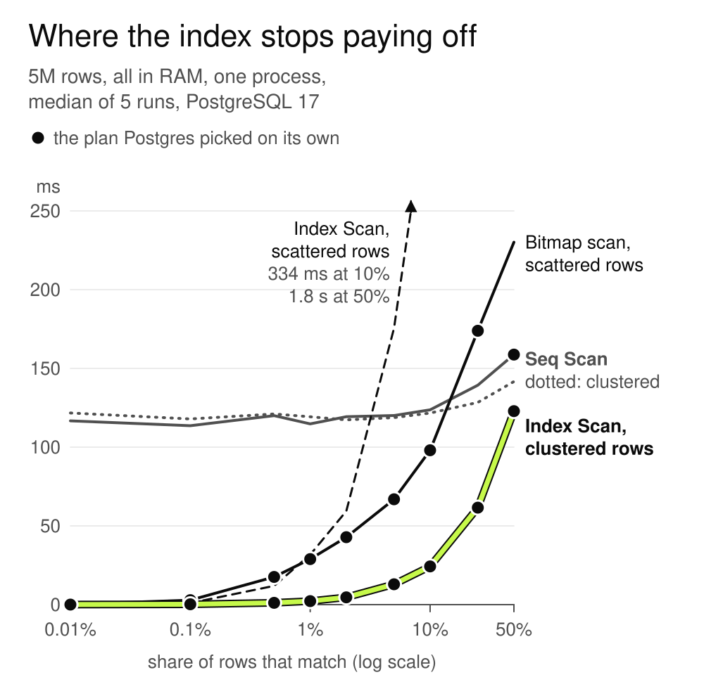

# Postgres not using your index? It's counting pages, not rows

Code and raw numbers for part 1 of Slow Postgres. The article is [on HackerNoon](https://hackernoon.com/postgres-not-using-your-index-its-counting-pages-not-rows).



What I measured on PostgreSQL 17.11, 4 vCPU EPYC, 8 GB RAM (full specs in [bench/machine.txt](bench/machine.txt)):

- Table in RAM, matches scattered: the bitmap scan beats Seq Scan up to 10% of the rows (98 ms vs 124). At 25% it loses (174 vs 139) and the planner still picks it.
- Table in RAM, matches stored together: the index wins at every share I tried, 50% included (123 ms vs 142).
- Cold cache, matches scattered: at 1% of the rows the bitmap scan takes 1.27 s, Seq Scan 255 ms.

## Run it yourself

You need Docker and Python 3. The timing scripts call `docker exec`, and the cold-cache one also calls `sudo` to drop the OS page cache, so run it on Linux.

```sh
# small lab: 30,000 orders on 221 pages, default settings
docker run -d --name pglab -e POSTGRES_HOST_AUTH_METHOD=trust postgres:17
docker exec -i pglab psql -U postgres < bench/01_orders_lab.sql

# 5 million rows, two copies: random order and sorted by bucket
docker run -d --name pg17bench -e POSTGRES_HOST_AUTH_METHOD=trust --shm-size=1g postgres:17 -c shared_buffers=2GB
docker exec -i pg17bench psql -U postgres < bench/02_big_setup.sql
docker exec -i pg17bench psql -U postgres < bench/03_pages.sql

cd bench
python3 bench.py pg17bench   # warm cache, writes results.json
python3 cold_full.py         # restarts Postgres before every run, writes cold_results_full.json
```

Each `.out` file is the output I got from the script with the same name.

The charts are plain SVG built with Node, no packages: `cd charts && node crossover.js`.
