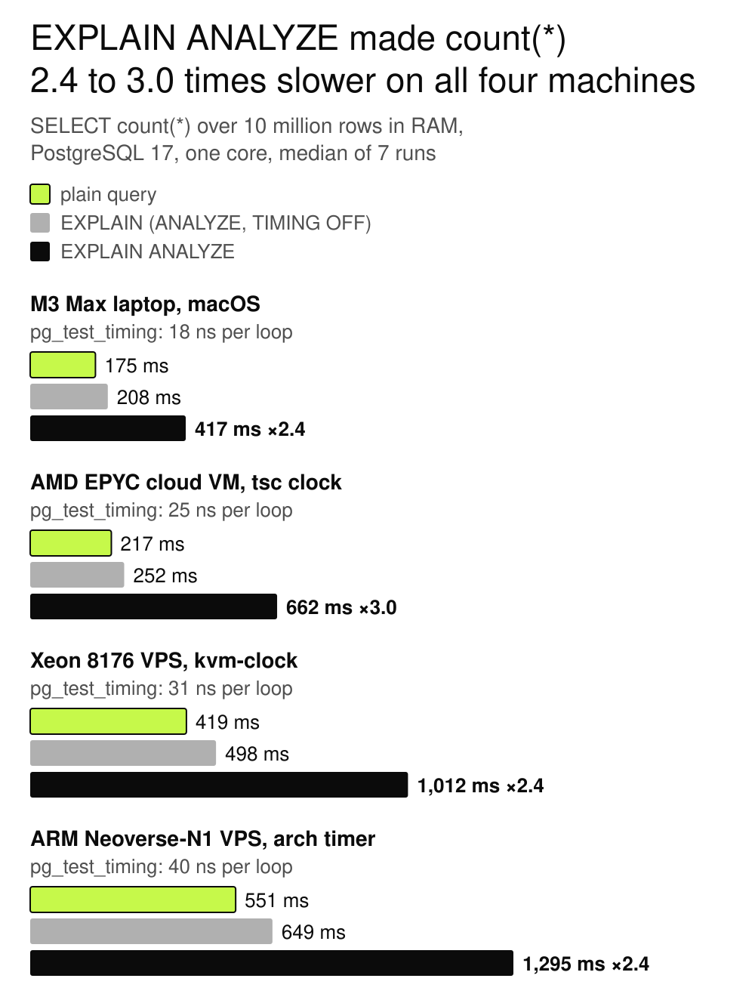

# Reading Postgres EXPLAIN ANALYZE when the planner expects 300 rows and gets 15,000

Code and raw numbers for part 2 of Slow Postgres. The article link goes here once it's live.



The walkthrough plans ran on PostgreSQL 17.12 in Docker on a 4 vCPU EPYC cloud VM with 8 GB RAM. The overhead test also ran on an M3 Max laptop, an AlphaVPS Xeon server and a netcup ARM server. Full specs for all of them are in [bench/machines.md](bench/machines.md).

- Cloud VM: the planner guessed 300 Lisbon users and got 15,000, so it picked a Nested Loop. With the data in memory that plan won, 159 ms against 344 for the Hash Join it picks with the right estimate. With the OS cache dropped it lost, 2.15 s against 455 ms.
- Cloud VM: after a restart both cold runs read the same 41,801 pages. They took 304 ms when the OS still had them cached and 2.15 s when they came off disk.
- All four machines: EXPLAIN ANALYZE made `count(*)` over 10 million rows 2.4 to 3.0 times slower (3.2 with the VM switched to kvm-clock). `pg_test_timing` measured 18 ns per clock read on the Mac, 25 on the VM, 31 on the Xeon and 40 on the ARM server.
- Cloud VM: raising `work_mem` from 4 MB to 64 MB removed the hash batches and the sort spill, and the query got slower (425 ms to 578 with `TIMING OFF`). On the Mac it got faster (418 to 341).

## Run it yourself

You need Python 3, plus Docker or a PostgreSQL 17 install. The cold-cache script calls `docker restart` and `sudo` to drop the OS page cache, so run it on Linux.

```sh
docker run -d --name pglab2 --shm-size=1g -e POSTGRES_HOST_AUTH_METHOD=trust postgres:17 \
  -c shared_buffers=1GB -c jit=off -c max_parallel_workers_per_gather=0
docker exec -i pglab2 psql -U postgres < bench/01_setup.sql      # 1M users, 5M orders, about 550 MB
docker exec -i pglab2 psql -U postgres < bench/02_plans.sql
docker restart pglab2 && docker exec -i pglab2 psql -U postgres < bench/03_planning.sql
docker exec -i pglab2 psql -U postgres < bench/04_rollback.sql

cd bench
python3 warm.py pglab2              # medians of 7 warm runs, writes warm.json
python3 cold.py pglab2              # restart + drop OS cache before every run, writes cold.json
OSCACHE=1 python3 cold.py pglab2    # restart only, writes cold-oscache.json
```

Without Docker, start a PostgreSQL 17 cluster with the same three settings, load the SQL with `psql`, and point `warm.py` at it:

```sh
PSQL="psql -h 127.0.0.1 -p 5498 -U postgres" OUT=warm-mine python3 warm.py
```

The overhead test is one command. It uses Docker if it works, otherwise PostgreSQL 17 from `PGBIN` or `PATH`, otherwise it installs PostgreSQL 17 from conda-forge into `~/pglab` without root. It starts its own cluster on 127.0.0.1:5499, writes `overhead-<host>.json` and `.out`, and deletes the cluster when it's done.

```sh
bash bench/overhead.sh --host my-server
MODE=native PGBIN=/usr/lib/postgresql/17/bin bash bench/overhead.sh --host my-server
```

Each `.out` file is the output I got from the script with the same name.

The charts are plain SVG built with Node, no packages: `cd charts && node hero.js && node cache.js && node overhead.js`.
